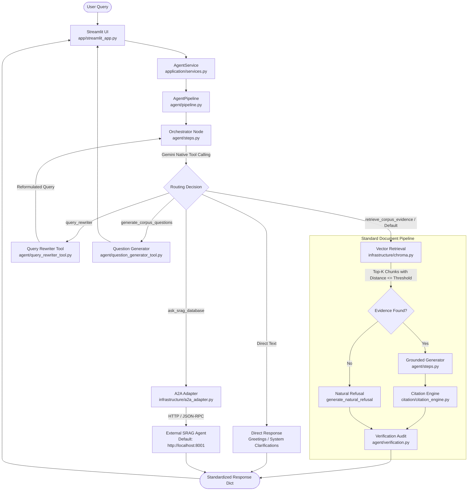

# Cadet Readiness Advisor — RAG System

An agentic Retrieval-Augmented Generation (RAG) system built with **LangChain**, **ChromaDB**, **PyMuPDF**, and the **Google GenAI SDK** (`gemini-3.8-flash`) for psychometric evaluation, ASVAB qualification standards, and military psychological readiness guidance.

The application features autonomous orchestration via **Gemini Native Tool Calling**, strict fact verification to mitigate hallucinations, source citation anchoring, structured Agent-to-Agent (A2A) database routing, and an interactive **Streamlit** web interface.

---

## Table of Contents

- [Key Features](#key-features)
- [System Architecture](#system-architecture)
- [Repository Structure](#repository-structure)
- [Prerequisites](#prerequisites)
- [Environment Configuration](#environment-configuration)
- [Installation](#installation)
  - [Method 1: Using uv (Recommended)](#method-1-using-uv-recommended)
  - [Method 2: Using standard pip and venv](#method-2-using-standard-pip-and-venv)
- [Vector Database Ingestion](#vector-database-ingestion)
- [Running the Application](#running-the-application)
- [RAG Pipeline Lifecycle](#rag-pipeline-lifecycle)
- [Embeddings, Distance Metrics & Thresholds](#embeddings-distance-metrics--thresholds)
- [Resilience: Rate Limiting, Retries & Quota Handling](#resilience-rate-limiting-retries--quota-handling)
- [Grounding & Hallucination Safeguards](#grounding--hallucination-safeguards)
- [External SRAG & A2A Integration](#external-srag--a2a-integration)
- [Automated Tests](#automated-tests)
- [Evaluation Benchmark & Limitations](#evaluation-benchmark--limitations)
- [Troubleshooting](#troubleshooting)
- [Security Notes](#security-notes)

---

## Key Features

- **Autonomous Agent Orchestration**: Uses `google.genai` native tool declarations (`FunctionDeclaration`) to route user queries without prompt-enforced JSON parsing.
- **Strict Grounding & Verification**: Employs an independent verification node (`verify_grounding`) that audits synthesized answers against retrieved evidence to detect hallucinations before display.
- **Citation Anchoring**: Automatically extracts, deduplicates, and formats source citations with exact document filenames and page numbers (`• asvab2.pdf — Page 11`).
- **Pre-Retrieval & Distance Gating**: Fast-fails on blank inputs and filters irrelevant/out-of-corpus queries using calibrated vector distance thresholds.
- **Production API Resilience**: Centralized exponential backoff with dynamic server retry-delay parsing for temporary `429`/`503` errors, paired with fast-fail detection for daily quota exhaustion.
- **Agent-to-Agent (A2A) Database Routing**: Connects to an external Structured RAG (SRAG) microservice via the standard A2A protocol over HTTP to query relational database records.
- **Interactive Web Interface**: Streamlit UI with conversation history, live evidence inspection, citation cards, PDF document downloads, and corpus summary metrics.

---

## System Architecture

The following diagram represents the execution flow from user query to verified response:



---

## Repository Structure

```
rag/
├── .env.example               # Environment variables template
├── .gitignore                 # Version control exclusions
├── .python-version            # Pinned Python version (3.11.9)
├── pyproject.toml             # Project metadata and dependencies (uv / pip)
├── requirements.txt           # Flat dependency manifest
├── uv.lock                    # Exact dependency lockfile for reproducible installs
├── render.yaml                # Render cloud deployment blueprint
├── config.py                  # Central configuration and hyperparameters
├── README.md                  # Primary project documentation
│
├── agent/                     # Agent execution nodes and tools
│   ├── pipeline.py            # Workflow coordinator (AgentPipeline)
│   ├── steps.py               # Step callables (orchestrator, retrieval, generation, verification)
│   ├── verification.py        # Independent factual audit node
│   ├── tool_declarations.py   # Gemini native FunctionDeclaration schemas
│   ├── query_rewriter_tool.py # Conversational pronoun/ellipsis rewriter
│   ├── question_generator_tool.py # Assessment question synthesis & batch verification
│   ├── prompts.py             # Re-export facade to application.prompts
│   └── state.py               # Re-export facade to core.models
│
├── app/                       # User presentation layer
│   └── streamlit_app.py       # Streamlit web application
│
├── application/               # Application service facade & prompt templates
│   ├── services.py            # AgentService interface for UI decoupling
│   └── prompts.py             # System instructions & LangChain message builders
│
├── citation/                  # Citation extraction & formatting
│   └── citation_engine.py     # Source deduplication and page citation blocks
│
├── core/                      # Shared domain abstractions & bootstrap registry
│   ├── models.py              # AgentState TypedDict schema
│   ├── registry.py            # Global ToolRegistry for decoupled step execution
│   └── bootstrap.py           # Auto-registration of tools on agent import
│
├── data/
│   └── raw/                   # 7 source PDF documents (ASVAB, APA, Military Psych)
│
├── chroma_db/                 # Persistent ChromaDB vector database index
│   └── chroma.sqlite3         # SQLite metadata storage
│
├── docs/                      # Technical documentation & benchmarks
│   ├── ARCHITECTURE.md        # Comprehensive architecture & execution flow guide
│   └── EVALUATION.md          # Benchmark dataset, threshold calibration, and test guide
│
├── evaluation/                # Ground truth benchmarking
│   └── evaluation_set.json    # 18 curated evaluation questions (answerable/unanswerable)
│
├── infrastructure/            # Concrete external service adapters
│   ├── a2a_adapter.py         # Official A2A client adapter to remote SRAG agent
│   ├── chroma.py              # ChromaRetriever vector store adapter
│   └── gemini.py              # GeminiLLM client with exponential backoff & quota handling
│
├── ingestion/                 # Ingestion, parsing, cleaning & chunking pipeline
│   ├── pdf_extractor.py       # PyMuPDF document extractor
│   ├── text_cleaner.py        # Text normalizer and noise filter
│   ├── chunker.py             # RecursiveCharacterTextSplitter wrapper
│   ├── vector_store.py        # Chroma persistent vector store builder & embeddings
│   ├── build_vector_db.py     # End-to-end ingestion script
│   ├── inspect_extraction.py  # Extraction diagnostic script
│   ├── inspect_cleaning.py    # Cleaning diagnostic script
│   └── inspect_chunking.py    # Chunking diagnostic script
│
└── tests/                     # Automated test suite (20 tests)
    ├── test_agent_orchestration.py # AgentPipeline, ToolRegistry, and routing tests
    ├── test_gemini_retry.py   # Rate limit, retry backoff, and daily quota tests
    └── test_grounding_and_hallucination.py # Anti-hallucination, threshold, and citation tests
```

### Documentation Guides

- **[Architecture Guide](docs/ARCHITECTURE.md)**: Comprehensive architectural breakdown of the 7-layer design, `AgentPipeline` coordination, `ToolRegistry`, and sequence diagrams.
- **[Evaluation & Verification Guide](docs/EVALUATION.md)**: In-depth documentation of the 18 ground-truth benchmark questions, empirical threshold calibration ($L^2 \le 0.22$), and test suite execution.

---

## Prerequisites

- **Python**: Version `3.11.9` or `>=3.11.9`
- **Google Gemini API Key**: Required for generation and embeddings ([Google AI Studio](https://aistudio.google.com/))
- **Operating System**: Windows, macOS, or Linux

---

## Environment Configuration

1. Copy the `.env.example` template to `.env`:
   ```bash
   cp .env.example .env
   ```

2. Configure the following variables in `.env`:

| Environment Variable | Required | Description | Default / Fallback |
| :--- | :---: | :--- | :--- |
| `GEMINI_API_KEY` | **Yes** | Google Gemini API key used by `GeminiLLM` and `GeminiEmbeddings`. | *None* (Raises `ValueError` if unset) |
| `SRAG_A2A_URL` | No | Base HTTP endpoint of the external Structured RAG agent service. | `http://localhost:8001` |

> [!IMPORTANT]
> The `.env` file contains sensitive secrets and is excluded from version control by `.gitignore`. Never commit API keys.

---

## Installation

### Method 1: Using `uv` (Recommended)

[`uv`](https://docs.astral.sh/uv/) provides fast, deterministic dependency resolution using `uv.lock`.

```bash
# 1. Install project dependencies into virtual environment (.venv)
uv sync
```

### Method 2: Using standard `pip` and `venv`

If you prefer standard Python tooling:

```bash
# 1. Create a virtual environment
python -m venv venv

# 2. Activate the virtual environment
# Windows PowerShell:
.\venv\Scripts\Activate.ps1
# Windows Command Prompt:
.\venv\Scripts\activate.bat
# Linux / macOS:
source venv/bin/activate

# 3. Install dependencies
pip install -r requirements.txt
```

*(Note for Windows users: If PowerShell execution policies prevent script activation, run `Set-ExecutionPolicy -Scope Process -ExecutionPolicy RemoteSigned` first).*

---

## Vector Database Ingestion

The repository includes a pre-indexed, committed ChromaDB database in `chroma_db/` containing all 7 source PDFs from `data/raw/`.

If you add new PDFs to `data/raw/` or wish to re-index from scratch:

```bash
# Using uv:
uv run python ingestion/build_vector_db.py

# Using standard virtual environment:
python ingestion/build_vector_db.py
```

**Ingestion Pipeline Stages:**
1. **Extraction** (`ingestion/pdf_extractor.py`): PyMuPDF extracts raw text and page-level metadata.
2. **Cleaning** (`ingestion/text_cleaner.py`): Removes header noise, page markers, and normalizes whitespace.
3. **Chunking** (`ingestion/chunker.py`): Splits text via `RecursiveCharacterTextSplitter` (`chunk_size=900`, `chunk_overlap=120`).
4. **Resumable Indexing** (`ingestion/vector_store.py`): Checks existing chunk IDs in ChromaDB and embeds only unindexed chunks in batches of 32 to conserve API quota.

---

## Running the Application

Launch the Streamlit web application:

```bash
# Using uv:
uv run streamlit run app/streamlit_app.py

# Using standard virtual environment:
streamlit run app/streamlit_app.py
```

Once started, Streamlit outputs the local URL in the console. Open your browser and navigate to:
👉 **`http://localhost:8501`**

---

## RAG Pipeline Lifecycle

When a query is submitted through the interface, the request executes through the following stages:

```
User Query ──► Input Validation ──► Autonomous Orchestrator ──► Retrieval ──► Grounded Generation ──► Citation Engine ──► Verification Node ──► UI Card
```

1. **Input Validation**: Blank or whitespace queries (`""`, `"   "`, `None`) short-circuit immediately with `status="EMPTY_QUERY"`.
2. **Autonomous Orchestrator** (`agent/steps.py`):
   - Sends query, recent history, and native Gemini tool declarations (`get_gemini_native_tools()`) to `GeminiLLM.generate_with_tools()`.
   - Direct conversational messages (greetings, system architecture questions) exit early as `DIRECT_RESPONSE`.
   - Ambiguous follow-ups route to `query_rewriter` to resolve conversational pronouns before downstream routing.
   - Database queries route to `ask_srag_database`.
   - Quiz generation queries route to `generate_corpus_questions`.
   - Reference/factual queries route to `retrieve_corpus_evidence`.
3. **Evidence Retrieval** (`infrastructure/chroma.py`):
   - Queries ChromaDB collection `cadet_readiness` for `INITIAL_TOP_K = 5` chunks.
   - Evaluates chunk distance scores against `SIMILARITY_THRESHOLD`. Chunks exceeding the threshold are discarded.
4. **Grounded Generation** (`agent/steps.py`):
   - If no chunks pass the threshold (`evidence = []`), bypasses synthesis and invokes `generate_natural_refusal()`, returning a polite refusal with `is_grounded = False` and `status = "NOT_IN_CORPUS"`.
   - If valid evidence exists, constructs a strict excerpt-bound prompt and requests structured JSON output from Gemini (`{"is_answerable": true/false, "answer": "..."}`).
5. **Citation Anchoring** (`citation/citation_engine.py`):
   - Extracts unique `(source, page)` tuples from retrieved chunks.
   - Appends a formatted markdown block (`\n\n---\n**Sources:**\n• asvab2.pdf — Page 11`).
6. **Fact Verification Audit** (`agent/verification.py`):
   - Submits the raw generated answer and retrieved evidence excerpts to a dedicated verification prompt.
   - Confirms whether all claims are supported by the excerpts.
   - Assigns verification status (`VERIFIED_SUPPORTED`, `UNSUPPORTED_HALLUCINATION`, or `REFUSAL_CONFIRMED`).
7. **Presentation Layer** (`app/streamlit_app.py`):
   - Renders answer text, distance metrics, status badges (`✅ ANSWERABLE & GROUNDED`, `🛡️ VERIFIED`), executed tools list, and collapsible evidence chunk debug panels.

---

## Embeddings, Distance Metrics & Thresholds

### 1. Embedding Provider Selection

Configured in `config.py`:
- `EMBEDDING_PROVIDER = "gemini"` (Default): Uses `gemini-embedding-001` via `GeminiEmbeddings` generating 768-dimensional dense vectors (`task_type="RETRIEVAL_DOCUMENT"` for indexing, `task_type="RETRIEVAL_QUERY"` for querying).
- `EMBEDDING_PROVIDER = "bge"` (Fallback): Uses `BAAI/bge-small-en-v1.5` via `HuggingFaceBgeEmbeddings` generating 384-dimensional dense vectors with `normalize_embeddings=True`.

### 2. Distance Metric Under the Hood

ChromaDB initializes collections with default configuration (`{"hnsw:space": "l2"}`), measuring **Squared Euclidean Distance ($L_2$)**:
$$d^2(u, v) = \sum_{i=1}^n (u_i - v_i)^2$$

Because Gemini and BGE embedding vectors are unit-normalized ($\|u\| = \|v\| = 1$), Squared Euclidean distance is directly related to Cosine Similarity ($\cos\theta$):
$$d^2(u, v) = 2 - 2\cos(\theta)$$

- A distance of `0.0` represents identical vectors.
- Lower distance values represent higher semantic similarity.

### 3. Calibrated Distance Thresholds

Defined in `config.py`:

```python
BGE_SIMILARITY_THRESHOLD = 0.85
GEMINI_SIMILARITY_THRESHOLD = 0.22

SIMILARITY_THRESHOLD = (
    GEMINI_SIMILARITY_THRESHOLD if EMBEDDING_PROVIDER == "gemini" else BGE_SIMILARITY_THRESHOLD
)
```

**Empirical Calibration:**
Distance distributions observed across the 18 benchmark queries in `evaluation/evaluation_set.json`:
- **Answerable in-corpus queries**: Top chunk distances range from **`0.1331` to `0.1976`** (e.g. ASVAB score means: `0.1401`, AFQT composite: `0.1715`).
- **Unanswerable / out-of-corpus queries**: Top chunk distances range from **`0.2259` to `0.2822`** (e.g. Navy SEAL PST cutoff: `0.2715`, recipe queries: `> 0.30`).

Setting `GEMINI_SIMILARITY_THRESHOLD = 0.22` ensures that out-of-corpus queries are rejected at the retrieval boundary, yielding `evidence = []` and triggering refusal before generation occurs.

---

## Resilience: Rate Limiting, Retries & Quota Handling

The Gemini LLM adapter (`infrastructure/gemini.py`) incorporates a centralized execution wrapper (`_call_with_retry`) applied across `generate_text`, `generate_json`, and `generate_with_tools`:

- **Temporary Error Retries (`429` & `503`)**: Catches transient HTTP `429` (Rate Limit / Resource Exhausted) and `503` (Service Unavailable / Overloaded) errors. Retries up to `DEFAULT_MAX_RETRIES = 3` times with exponential backoff (`initial_delay = 1.0s`, `backoff_factor = 2.0`, capped at `60.0s`).
- **Dynamic Server Retry-Delay Parsing**: Uses regex to extract server-suggested delays (e.g. `retry in 5.2s` or `retry after 10s`) and adds a 1.0-second safety buffer.
- **Daily Quota Fast-Fail (`GeminiDailyQuotaExhausted`)**: Distinguishes transient rate limits from daily exhaustion (e.g. `requests per day`, `rpd`, `free_tier_requests_per_day`, or server retry delays $> 300\text{s}$). Daily quota errors raise `GeminiDailyQuotaExhausted` immediately to prevent wasted retries.
- **Permanent Error Propagation**: Client errors such as `400 Bad Request`, `401 Unauthorized`, `403 Forbidden`, and `404 Not Found` fail fast without retrying.

---

## Grounding & Hallucination Safeguards

The application employs a defense-in-depth approach to mitigate hallucinations:

| Defense Tier | Mechanism | Implementation |
| :--- | :--- | :--- |
| **Tier 1: Pre-Retrieval Guard** | Fast-fails empty and whitespace-only queries. | `agent/pipeline.py` (`EMPTY_QUERY`) |
| **Tier 2: Vector Distance Gating** | Discards chunks with distance $> 0.22$, returning empty evidence. | `infrastructure/chroma.py` |
| **Tier 3: Natural Refusal Fallback** | Generates an explicit polite refusal when evidence is empty or insufficient. | `agent/steps.py` (`NOT_IN_CORPUS`) |
| **Tier 4: Strict Prompt Directives** | Instructs model to rely exclusively on excerpts and output `is_answerable: false` if facts are missing. | `application/prompts.py` |
| **Tier 5: Mandatory Citations** | Extracts and deduplicates source PDF names and pages. | `citation/citation_engine.py` |
| **Tier 6: Independent Verification Node** | Audits the synthesized text against retrieved evidence; flags unsupported claims. | `agent/verification.py` (`verify_grounding`) |

> [!NOTE]
> **Honest Limitation**: While these safeguards significantly reduce unsupported statements and enforce source attribution, no LLM pipeline can mathematically guarantee zero hallucinations. Ambiguous questions or edge-case formulations may occasionally trigger heuristic verification fallbacks.

---

## External SRAG & A2A Integration

The system supports hybrid query routing across unstructured documents and structured databases:

- **Client Implementation** (`infrastructure/a2a_adapter.py`): Uses `a2a-sdk` to discover the agent card at `/.well-known/agent-card.json` and transmit queries via the Agent-to-Agent protocol over HTTP/JSON-RPC.
- **Synchronous Compatibility**: Uses `run_coroutine_sync()` with a dedicated `ThreadPoolExecutor` worker to safely execute async A2A calls within synchronous Streamlit runtimes.
- **External Dependency Boundary**: The remote SRAG server, Model Context Protocol (MCP) server, and PostgreSQL database are **separate services** not hosted in this repository.
- **Graceful Degradation**: If the external SRAG agent is not running at `SRAG_A2A_URL`, database queries return a clear status message:
  ```
  Unable to query the structured database: The remote SRAG agent at http://localhost:8001
  is currently unreachable (ConnectError). Please ensure the SRAG A2A server is running.
  ```
  Corpus document retrieval continues to operate normally.

---

## Automated Tests

The repository contains focused unit and integration test suites under `tests/`:

### 1. Test Modules

The repository contains **20 focused unit and integration tests** under `tests/`:

- `tests/test_agent_orchestration.py` (5 Architecture & Orchestration Tests):
  - `ToolRegistry` lifecycle (registration, lookup, listing, unregistering, error handling).
  - `AgentPipeline` empty input handling (`""`, `"   "`, `None` -> `EMPTY_QUERY`).
  - Terminal early-exit handling (direct text responses exit without triggering retrieval).
  - End-to-end standard workflow dispatch (`orchestrator` → `retrieval` → `generation` → `verification`).
  - `AgentService` message dictionary formatting for UI consumers.

- `tests/test_gemini_retry.py` (9 Unit Tests):
  - Daily quota exhaustion detection and fast-fail behavior (`GeminiDailyQuotaExhausted`).
  - Retryable error detection (`429` and `503`).
  - Server-reported retry delay extraction (`retry in X seconds` + 1s buffer).
  - Immediate propagation of non-retryable permanent errors (`400`, `401`).
  - Exponential backoff verification and retry exhaustion.
  - Consistent wrapper application across `generate_text`, `generate_json`, and `generate_with_tools`.

- `tests/test_grounding_and_hallucination.py` (6 Integration & Unit Tests):
  - Empty input handling (`""`, `"   "`, `None`) returning `EMPTY_QUERY`.
  - Vector threshold pre-filtering on out-of-corpus queries.
  - In-corpus answerable retrieval retaining chunks within threshold.
  - Out-of-corpus query refusal synthesis without false citations.
  - In-corpus answerable query execution verifying citation attachment (`asvab2.pdf`).
  - Verification node hallucination detection (`UNSUPPORTED_HALLUCINATION`).

### 2. Running Tests

Run the complete test suite:

```bash
# Using uv:
uv run python -m unittest discover -s tests -p "test_*.py"

# Using standard virtual environment:
python -m unittest discover -s tests -p "test_*.py"
```

Run individual test files:

```bash
# Agent orchestration and pipeline tests:
uv run python -m unittest tests/test_agent_orchestration.py

# Retry and rate-limiting tests:
uv run python -m unittest tests/test_gemini_retry.py

# Grounding, threshold, and hallucination tests:
uv run python -m unittest tests/test_grounding_and_hallucination.py
```

---

## Evaluation Benchmark & Limitations

### 1. Ground Truth Benchmark Dataset

The file `evaluation/evaluation_set.json` provides 18 curated benchmark items:
- **8 Answerable Questions**: Fact-based questions with target documents and ground-truth answers (e.g. Cronbach's Alpha thresholds in `apa1.pdf`, ASVAB score distributions in `asvab2.pdf`).
- **5 Unanswerable Questions**: Questions intentionally outside the corpus scope (e.g. Navy SEAL PST swim cutoffs, SAT Math cutoffs, MMPI-3 clinical scales).
- **5 Multi-Document Comparison Questions**: Comparative questions requiring synthesis across multiple PDFs (e.g. MTMTI vs. APA baseline reliability).

### 2. Known Limitations

- **Benchmark Execution**: There is currently no automated benchmark harness script committed in `evaluation/`. The dataset serves as a curated ground-truth reference for verification and test assertions.
- **Model Quota Sensitivity**: Google Gemini free-tier quotas on newer preview models may have constrained daily request limits (`RPD`). When evaluating or testing, ensure your API key has sufficient quota or configure an appropriate model in `config.py`.

---

## Troubleshooting

### 1. `ValueError: GEMINI_API_KEY is not set in environment or .env file`
- Ensure `.env` exists in the project root directory and contains `GEMINI_API_KEY=your_actual_key`.
- If running in Docker or cloud environments, pass `GEMINI_API_KEY` as an environment variable.

### 2. `GeminiDailyQuotaExhausted: Gemini daily quota exhausted`
- Google's free-tier daily request quota for the configured model has been reached.
- Check quota status at [Google AI Studio](https://aistudio.google.com/) or switch to a paid tier key.

### 3. `Unable to query the structured database: ConnectError`
- The application attempted to query the relational database via `ask_srag_database`, but no remote SRAG A2A service is running at `SRAG_A2A_URL` (default: `http://localhost:8001`).
- Document corpus queries are unaffected.

### 4. PowerShell Script Execution Error on Windows
- If `.\venv\Scripts\Activate.ps1` produces a `PSSecurityException`, run:
  ```powershell
  Set-ExecutionPolicy -Scope Process -ExecutionPolicy RemoteSigned
  ```

---

## Security Notes

- **Secrets Handling**: Never commit `.env` or files containing raw API keys to Git.
- **Git Ignore**: Verify `.gitignore` contains `.env`, `*.pem`, `*.key`, and `.streamlit/secrets.toml`.
- **Read-Only Ingestion**: Document extraction reads PDFs locally from `data/raw/` without external network transmission.
- **Model Sandbox**: Automatic function execution is disabled (`automatic_function_calling=False`) so the Python orchestrator retains complete lifecycle control over tool execution.
