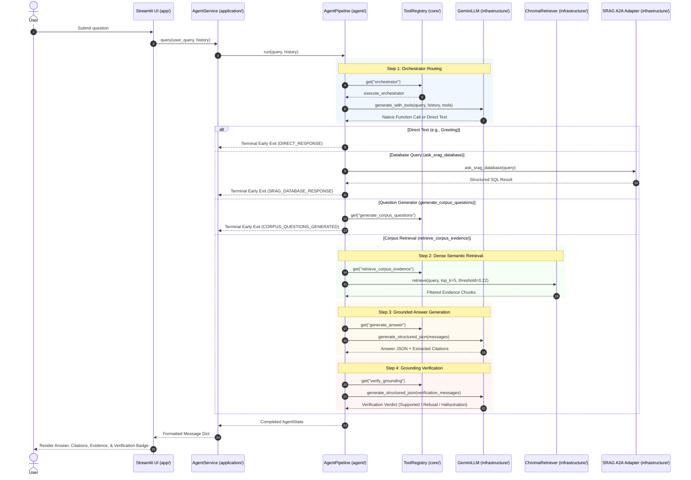

# Architecture Guide — Cadet Readiness Advisor

## 1. System Overview

The **Cadet Readiness Advisor** is a production-grade, agentic Retrieval-Augmented Generation (RAG) system engineered for psychometric standards, ASVAB qualification benchmarks, and military psychological readiness research.

The architecture follows a clean, modular design with strict separation of concerns across 7 distinct layers:

```
┌────────────────────────────────────────────────────────┐
│                   Web User Interface                   │
│                  (app/streamlit_app.py)                │
└───────────────────────────┬────────────────────────────┘
                            │
┌───────────────────────────▼────────────────────────────┐
│                    Application Layer                   │
│   • application/services.py (AgentService Facade)      │
│   • application/prompts.py  (System Directives)        │
└───────────────────────────┬────────────────────────────┘
                            │
┌───────────────────────────▼────────────────────────────┐
│                   Core Domain Layer                    │
│   • core/models.py   (AgentState TypedDict)            │
│   • core/registry.py (ToolRegistry Singleton)          │
│   • core/bootstrap.py (Zero-config tool wiring)        │
└───────────────────────────┬────────────────────────────┘
                            │
┌───────────────────────────▼────────────────────────────┐
│               Agent Orchestration Layer                │
│   • agent/pipeline.py          (AgentPipeline Engine)  │
│   • agent/steps.py             (Step Callables)        │
│   • agent/tool_declarations.py (Native Gemini Schemas) │
│   • agent/verification.py      (Fact-Check Evaluator)  │
│   • agent/query_rewriter_tool.py (Context Resolvers)   │
│   • agent/question_generator_tool.py (Assessment Quiz) │
└───────────────────────────┬────────────────────────────┘
                            │
┌───────────────────────────▼────────────────────────────┐
│                  Infrastructure Layer                  │
│   • infrastructure/gemini.py   (Resilient GenAI SDK)   │
│   • infrastructure/chroma.py   (ChromaDB Vector Store) │
│   • infrastructure/a2a_adapter.py (SRAG / PostgreSQL)  │
└───────────────────────────┬────────────────────────────┘
                            │
┌───────────────────────────▼────────────────────────────┐
│                Citation & Ingestion Layer              │
│   • citation/citation_engine.py (Deduplicated Sources) │
│   • ingestion/build_vector_db.py (ChromaDB Ingestion)  │
│   • ingestion/chunker.py, pdf_extractor.py, etc.       │
└────────────────────────────────────────────────────────┘
```

---

## 2. Layer Responsibilities

### A. Presentation Layer (`app/`)
- **`app/streamlit_app.py`**: Modern, responsive web user interface. It renders chat history, expandable retrieved evidence cards with source badges, factual verification audits, and generated assessment quizzes.
- **Contract**: Interacts **exclusively** with `application.services.AgentService`. It has no direct dependencies on Gemini, ChromaDB, or SQL databases.

### B. Application Layer (`application/`)
- **`application/services.py`**: Defines `AgentService`, a high-level facade that encapsulates `AgentPipeline` execution, sanitizes user inputs, and formats pipeline outputs into standardized message dictionaries for UI consumers.
- **`application/prompts.py`**: Central repository for all system prompts, few-shot examples, query resolution templates, and LangChain message builders (`build_generation_messages`, `messages_to_gemini_args`).

### C. Core Domain Layer (`core/`)
- **`core/models.py`**: Contains the single domain schema `AgentState` (TypedDict) tracking the complete lifecycle of a query (query, history, evidence, tools_used, citations, verification status).
- **`core/registry.py`**: `ToolRegistry` is a thread-safe singleton dictionary mapping tool identifiers to executable callables.
- **`core/bootstrap.py`**: Composition root that automatically registers all application steps into `ToolRegistry` upon package initialization.

### D. Agent Orchestration Layer (`agent/`)
- **`agent/pipeline.py`**: Registry-driven coordinator (`AgentPipeline`). Runs the orchestrator, evaluates early terminal exits (direct responses, quizzes, empty queries), and chains downstream RAG steps (`retrieve_corpus_evidence` → `generate_answer` → `verify_grounding`).
- **`agent/steps.py`**: Concrete step functions:
  - `execute_orchestrator`: Uses Gemini Native Tool Calling to autonomously decide whether to retrieve documents, query the database, generate assessment questions, rewrite queries, or answer directly.
  - `execute_retrieval`: Queries ChromaDB via `infrastructure.chroma`.
  - `execute_generation`: Synthesizes grounded answers or polite refusals via `infrastructure.gemini`.
  - `execute_verification`: Fact-checks generated answers against retrieved chunks via `agent.verification`.
  - `execute_srag_database`: Dispatches structured relational queries to the remote SRAG service via `infrastructure.a2a_adapter`.
  - `execute_question_generator`: Synthesizes multi-format assessment questions via `agent.question_generator_tool`.
- **`agent/tool_declarations.py`**: Declares native Gemini tool schemas for `retrieve_corpus_evidence`, `ask_srag_database`, `generate_corpus_questions`, and `query_rewriter`.
- **`agent/verification.py`**: Fact-checking node that inspects whether the generated answer is strictly supported by evidence excerpts.
- **`agent/state.py` & `agent/prompts.py`**: Clean, lightweight re-export facades to `core.models` and `application.prompts` for backward compatibility.

### E. Infrastructure Adapters (`infrastructure/`)
- **`infrastructure/gemini.py`**: Production Gemini client (`GeminiLLM`). Implements exponential backoff on `429`/`503` errors, parses server retry delays (`retry in Xs`), and fails fast on daily quota exhaustion (`requests_per_day`).
- **`infrastructure/chroma.py`**: Encapsulates ChromaDB vector store interactions (`ChromaRetriever`), lazy loading, and distance threshold filtering.
- **`infrastructure/a2a_adapter.py`**: Implements the official Agent-to-Agent (A2A) JSON-RPC protocol to communicate with the external SRAG microservice.

### F. Citation & Document Ingestion (`citation/`, `ingestion/`)
- **`citation/citation_engine.py`**: Extracts unique source-page pairs, sorts them deterministically, and formats markdown citation blocks.
- **`ingestion/build_vector_db.py`**: End-to-end pipeline script extracting text from raw PDFs (`ingestion/pdf_extractor.py`), cleaning text (`ingestion/text_cleaner.py`), splitting into chunks (`ingestion/chunker.py`), and embedding into ChromaDB (`ingestion/vector_store.py`).

---

## 3. End-to-End Execution Flow



---

## 4. Key Architectural Patterns & Decisions

1. **Registry-Driven Extensibility**:
   Step callables are decoupled from the pipeline loop. New tools can be registered in `ToolRegistry` without changing `AgentPipeline.run()`.
2. **Native Tool Calling Over Prompt Forcing**:
   Instead of fragile system-prompt regex JSON extraction, routing is handled via Gemini's native tool calling (`generate_with_tools`), delivering reliable dispatching.
3. **Defense-in-Depth Grounding**:
   - *Tier 1: Pre-retrieval Empty Checks* (guards against blank inputs).
   - *Tier 2: Vector Distance Threshold* ($L^2 \le 0.22$ filters out-of-corpus queries before LLM generation).
   - *Tier 3: In-Prompt Strict Grounding* (forces `is_answerable: false` when facts are absent).
   - *Tier 4: Post-Generation Verification Audit* (independent second-pass validation).
4. **Transient vs. Quota Resilience**:
   Retry logic in `infrastructure/gemini.py` differentiates between temporary rate limits (429/503 with exponential backoff) and hard daily exhaustion limits (`requests_per_day`), terminating immediately when daily quotas are reached to protect system stability.
